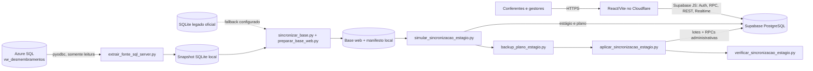

# Arquitetura atual

Documento extraído do código em **17/10/2026**. Ele descreve o checkout, não garante que todas as definições SQL locais correspondam ao banco de produção.

## Visão geral

## Componentes

### Aplicação web

`src/main.jsx` contém login, fila, modal de análise, produtividade, pendências, reconferência pessoal, prioridades e monitoramento. `src/reservaPagina.js` isola o estado por usuário/aba/caso, serializa operações concorrentes no navegador e guarda rascunhos/retomada. `src/supabase.js` inicializa o cliente público.

O navegador usa somente a chave pública. Segurança, posse do caso, reavaliação, idempotência e permissões são confirmadas novamente por RPCs e triggers no PostgreSQL.

### Backend Supabase

As tabelas centrais conhecidas são `matriculas`, `casos`, `revisoes`, `revisoes_historico`, `reservas` e `perfis`. Há tabelas auxiliares para atividade, opções de filtros, prioridades, notificações, estágio e plano de sincronização. O frontend chama RPCs para busca, contagens, reserva/renovação/liberação, salvamento, acesso ao Backoffice e relatórios.

As definições estão distribuídas entre `sql/migracoes_aplicadas/` e correções posteriores em `sql/`. Como funções foram substituídas em produção ao longo do tempo, o estado real precisa ser exportado antes de uma reconstrução.

### Entrada e processamento de dados

`scripts/atualizar_base_oficial.py` escolhe `azure_sql` ou `sqlite` a partir de uma configuração local ignorada. Azure é lido por `scripts/extrair_fonte_sql_server.py`, que valida contrato, integridade, referências e similaridade antes de produzir o snapshot.

`scripts/sincronizar_base.py` normaliza textos/URLs, classifica status, ordena o par, calcula `caso_id`, consolida linhas repetidas e aplica o corte de escopo. `scripts/preparar_base_web.py` separa matrículas dos casos, calcula hashes e gera manifesto de versão.

### Planejamento e aplicação

O fluxo atual envia a base preparada para tabelas de estágio, pede ao banco um plano e salva um backup antes da aplicação. A aplicação seleciona somente as chaves do plano, protege casos e matrículas com reserva ativa, envia lotes e atualiza caches/resumos. Se existirem adiamentos, a carga permanece parcial.

Para Azure, a política local pretende arquivar somente pendentes ausentes, preservando casos com revisão e revalidando reservas no servidor. Essa política depende de SQL compatível já instalado.

### Saídas

- interface SPA para operação diária;
- decisões vigentes e versões históricas no Supabase;
- relatórios de produtividade, pendências e prioridades;
- snapshots, manifestos, planos, logs e backups locais, todos fora do Git;
- build estático em `dist/`, publicado pelo Cloudflare.

## Dependências entre módulos

| Módulo | Depende de | Consumido por |
|---|---|---|
| `regras_fonte.py` | regra explícita de status | `sincronizar_base.py` e testes |
| `sincronizar_base.py` | SQLite, regras e banco de controle | preparação, validação e ferramentas |
| `extrair_fonte_sql_server.py` | contrato SQL Server, `pyodbc` | entrada Azure |
| `preparar_base_web.py` | sincronizador local | simulador e aplicador |
| `sincronizar_supabase_web.py` | `requests`, credenciais privadas | simulação, backup, aplicação e ferramentas |
| `reservaPagina.js` | Web Locks e storage do navegador | `main.jsx` e testes Node |
| SQL/RPCs | Auth, RLS e tabelas Supabase | frontend e scripts administrativos |

## Limites de confiança

- A trava da atualização é local e não impede dois computadores diferentes.
- Realtime atualiza a interface, mas não concede posse; a decisão do banco prevalece.
- O snapshot comprova integridade do que foi lido, não que a view Azure terminou sua regeneração.
- Os testes locais não comprovam RLS, lock e desempenho de produção.
- A carga Azure referenciada na documentação ficou parcial; consulte o servidor antes de retomar.
