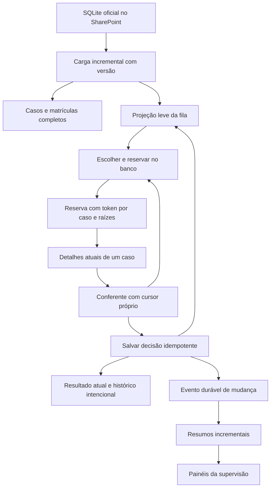

# Plano para o Sol: integridade, fila concorrente e desempenho

Data: 18/09/2026. Estado: P0 aplicado, publicado e incidente recuperado.

## Estado da execução em 18/09/2026

Implementado e validado localmente:

- frontend usa contratos V2, token de reserva e identificador exclusivo por aba;
- primeira análise nunca solicita reavaliação no avanço automático;
- salvamento possui chave idempotente e não substitui revisão existente no modo comum;
- reavaliação compara a versão esperada e só cria histórico quando há alteração;
- renovação, liberação e acessos ao Backoffice exigem a mesma reserva e a mesma aba;
- o avanço automático permanece na página atual e não volta sozinho à página 1;
- migração, auditoria pós-migração e encerramento posterior dos contratos V1 foram preparados;
- auditoria somente leitura confirmou 1.194 versões históricas, 1.183 criadas em 18/09,
  sendo 1.169 substituições em até cinco minutos. O CSV foi salvo em
  `backups/auditoria_concorrencia_2026-09-18.csv` e não altera a base.

Concluído depois da elaboração inicial:

- contratos V2 instalados e todos os campos da auditoria retornaram `true`;
- frontend V2 publicado na `main` e testado com uma primeira análise real;
- contratos V1 bloqueados para `authenticated`;
- 512 casos restaurados integralmente à primeira revisão;
- 1.194 versões acidentais preservadas em backup interno e externo, fora do
  histórico usado pela produtividade.

Ainda pendente:

1. fazer o ensaio controlado progressivo com 10, 20, 30 e 50 sessões;
2. reconciliar as funções alteradas diretamente pela IA do Supabase antes das
   otimizações P1 de consultas, cache e paginação por cursor.

## 1. Escopo e instrução de retomada

Este documento começou como análise e agora também registra a execução. Nenhum SQL
novo deste plano foi aplicado no banco e nenhum deploy foi publicado. A única leitura
da produção foi a auditoria das revisões e do histórico; nenhum registro foi alterado.

O usuário informa que mudou de Nano para Micro no Pro e fez otimizações diretamente com a IA do Supabase. Portanto, o SQL no Git NÃO é prova da definição vigente no banco. A implementação deve começar pela reconciliação de definições, sem sobrescrever essas alterações.

Objetivo: permitir vários conferentes no mesmo município, sem repetição involuntária, sem perda de decisões, com avanço contínuo e uso econômico do Micro. Meta de validação: 10, 20 e 50 sessões; capacidade não garantida antes da medição.

Prompt para iniciar a execução em outra tarefa:

> Leia docs/PLANO_SOL_CONCORRENCIA_E_DESEMPENHO.md e verifique o estado atual do Git. Implemente por etapas, começando pela reconciliação do schema real e pelas proteções P0. Preserve dados e alterações feitas no Supabase. Prepare migrações, testes e instruções de publicação. Não execute limpeza de revisões, carga de teste nem migração em produção com base apenas neste plano; apresente o impacto e use a autorização específica da etapa. Se faltar acesso ao catálogo, avance na implementação isolada e registre as verificações pendentes. Não declare concluído o que só foi preparado localmente.

## 2. Diagnóstico com evidência e limites

| Prioridade | Evidência no repositório | Consequência |
|---|---|---|
| P0 | src/main.jsx, reservarEabrir: permitirRevisao=false só rejeita caso.situacao do objeto recebido. A RPC não recebe intenção de primeira análise/reavaliação. setCasoAberto usa o objeto antigo. | Uma página em cache pode autorizar visualmente uma primeira análise de caso já concluído. |
| P0 | sql/migracoes_aplicadas/CORRIGIR_RESERVA_APOS_FECHAR_NAVEGADOR.sql: reservar_caso_web valida atividade/acesso e reservas, mas não consulta revisão para impedir reabertura comum. | Exclusão mútua durante uma reserva não impede repetição depois de salvar e liberar. |
| P0 | sql/migracoes_aplicadas/ADICIONAR_FALSO_POSITIVO.sql: salvar_revisao_web usa ON CONFLICT(caso_id) DO UPDATE; não distingue primeira análise de revisão intencional. | Um novo salvamento pode substituir resultado anterior e autoria. Checar definição real antes de concluir que isso ocorreu. |
| P0 | Nesse salvamento, leitura da reserva não usa FOR UPDATE e exclusão final é por caso_id; abertura/renovação usa outro protocolo de locks. | Há janela potencial entre validar posse e salvar, especialmente com expiração/troca de reserva. Reproduzir em teste. |
| P0 | sql/ESTABILIZAR_CACHE_FILA_PRODUCAO.sql mantém JSON completo por 5 minutos; não há invalidação por salvamento nesse arquivo. | Atraso visual de situação, decisão e responsável. Aumentar TTL reduziu consultas, mas agravou a defasagem operacional. |
| P1 | Mesmo arquivo devolve [] se não obtiver o lock e não houver cache. | Ocupação momentânea é apresentada como ausência de casos. |
| P1 | src/main.jsx, salvo: com Todos força proximaPagina=0 e setPagina(0); com página vazia pode voltar uma página. | Retorno à primeira página é comportamento explícito, não apenas impressão do usuário. |
| P1 | Avanço tenta candidatos locais sequencialmente, depois busca página por OFFSET. | Vários analistas disputam os mesmos candidatos; mudanças na fila deslocam páginas. |
| P1 | Sessão persistida em localStorage por usuário; reserva permite retomada do mesmo usuário e apaga sua reserva anterior; heartbeat reutiliza reservar_caso_web. | Abas antigas podem competir entre si, reabrir caso/liberar outro; pagehide pode interferir na aba ativa. |
| P1 | src/main.jsx: toda mudança Realtime em reservas chama listar_bloqueios_matriculas_web; também há timer de 30s, focus e visibilitychange. | Um evento pode provocar leitura por todas as sessões, inclusive em renovação. Sem deduplicação global desse fluxo. |
| P1 | Presença escrita a cada 15s; renovação a cada 45s; listagem com fotos/detalhes em JSON; contagens por filtro separadas. | Custo multiplicado pelo número de usuários, inclusive chamadas que não entregam trabalho. |
| P1 | CORRIGIR_RESUMO_FILTRADO_FILA_LIVRE materializa todos os IDs do filtro e calcula contagens. OTIMIZAR_PAINEL_PENDENCIAS ainda agrega revisões. | Cache de páginas não cobre todos os consumidores pesados; relatórios também crescem. |
| P1 | ADICIONAR_HISTORICO_REAVALIACOES: trigger arquiva OLD quando revisado_em muda; produtividade soma revisões e histórico. | Retentativas/revisões acidentais podem inflar produção se forem tratadas como novo trabalho. |
| P2 | scripts/sincronizar_supabase_web.py lê reservas antes dos lotes e adia alterações; proteção não está na transação da escrita. | Outra reserva pode começar entre a fotografia inicial e a carga. |

Não atribuir todo timeout a uma única RPC pelo trecho cortado do log. Parâmetros de filtros também aparecem em outras funções. Não afirmar que o Micro resolveu a causa ou que cache reduz carga real em 37 vezes: isso não foi medido.

### Caso, matrícula e histórico são coisas diferentes

scripts/sincronizar_base.py, id_par: caso_id deriva do par de códigos normalizados e ordenados. A–B e A–C são casos distintos, embora compartilhem A. O bloqueio existente usa a raiz anterior ao hífen.

- Mesmo caso concluído novamente: precisa ser recusado no fluxo comum; só reavaliação explícita pode alterar resultado.
- Outro par com uma raiz já trabalhada: pode ser trabalho legítimo ou redundante; depende da decisão anterior e da ação no Backoffice.
- Histórico atual guarda a versão anterior substituída, não toda matrícula já vista. A ausência de histórico não prova ausência de repetição entre pares.
- Não apagar nem mover registros em massa entre revisoes e revisoes_historico. Primeiro investigar amostra por caso, par, raiz, usuário e horário. Revisões comuns são esperadas em revisoes.
- O código verifica abertura dos links, mas não comprova que uma alteração externa foi enviada/concluída. Confirmar o que o usuário quis dizer com “ainda não foi enviado”: salvamento deste app, alteração no Backoffice ou sincronização diária. São transações diferentes.

## 3. Regras que precisam ser verdadeiras no banco

1. Primeira análise só salva se não existir decisão anterior para o caso; concorrência não pode converter INSERT em UPDATE.
2. Reavaliação é ação explícita, autorizada e versionada, com motivo; automático nunca seleciona concluídos nem inconclusivos para reavaliação.
3. Toda escrita exige usuário autenticado, escopo permitido, reserva vigente, token da reserva e versão esperada dos dados. Cliente não define autoria.
4. Mesma chave de operação reenviada retorna o mesmo resultado sem nova revisão, histórico ou produtividade; payload divergente com a mesma chave é rejeitado.
5. Casos distintos que compartilham raiz não são editados simultaneamente. SKIP LOCKED apenas no caso não garante isso.
6. Renovação só prolonga a reserva existente. Não adquire outro caso, não recria uma reserva finalizada e não transfere posse.
7. Resposta perdida após COMMIT não significa falha de salvamento. A interface verifica a operação antes de reenviar.
8. Falha ao obter próximo caso não desfaz o que foi salvo. Fim da fila, disputa temporária, falha de rede e falta de autorização são estados distintos.
9. Relatório atrasado nunca autoriza uma análise. Reserva/decisão são verificadas em dados atuais, sem cache operacional longo.
10. Alterações na base oficial não apagam decisões nem reabrem casos automaticamente; mudanças relevantes exigem regra e versão explícitas.

## 4. Primeira entrega: correções P0 antes da reestruturação

Não esperar uma fila nova completa para corrigir a integridade.

- Introduzir contratos distintos para primeira análise, retomada de inconclusivo e reavaliação. Preferir RPCs v2 com nomes e respostas explícitos.
- No banco, bloquear e revalidar caso/reserva antes de reservar e salvar; operação comum recusa conclusão existente mesmo se cliente disser Pendente.
- Primeira decisão deve ser inserção exclusiva por caso_id. Conflito retorna ja_concluido e dados atuais permitidos; nunca sobrescreve silenciosamente.
- Reserva devolve o estado atual e versão do caso. Modal usa essa resposta, não o objeto que veio da lista antiga.
- Introduzir chave idempotente persistida no cliente até confirmação e recibo durável no banco. Após sucesso, remover/atualizar imediatamente o caso na lista local.
- Renovação e liberação devem exigir token e aba dona; chamadas atrasadas não afetam a próxima reserva.
- Desabilitar fechar/trocar caso enquanto há salvamento em voo; preservar rascunho em falha. Impedir dois pedidos simultâneos de abrir/avançar.
- Tratar lista ocupada como tentando novamente/indisponível momentaneamente, nunca [] artificial. Não liberar cache velho para decidir próximo caso.
- Retirar reinício automático em zero e retorno de página. Guardar posição do caso salvo e buscar estritamente depois dela.
- Proteger também endpoints antigos: retornar atualização necessária quando o contrato seguro não puder ser satisfeito. Frontend antigo em aba aberta não pode continuar com UPSERT permissivo. Mostrar atualização e preservar rascunho antes de recarregar.

## 5. Arquitetura alvo: poucas consultas pequenas, posse forte

Usar Postgres/Supabase e o frontend existentes. Não adicionar Redis, Kafka ou outro serviço pago sem evidência de necessidade. Nova projeção só entra se medições mostrarem vantagem; tabelas atuais já contêm município e similaridade e podem bastar com consultas/índices adequados. P0 independe dessa decisão.

### Dados propostos e responsabilidades

| Estrutura | Conteúdo e invariantes |
|---|---|
| casos / matriculas | Dados de origem; detalhes grandes consultados apenas ao abrir. Preservar identidade do par. |
| fila_operacional | Uma linha estreita por caso: ID, chave de ordenação estável, ativo, tipo, similaridade, raízes, versão de origem, estado de decisão e versão de resultado. Sem fotos/textos extensos. Projeção reconstruível, não segunda fonte independente. |
| fila_municipios | Vínculos únicos município/caso. Deduplicar quando A e B têm mesmo município. Para desempenho, avaliar campos estreitos de ordenação/filtro replicados com manutenção transacional. |
| reservas | Token aleatório, caso, usuário, aba, expiração, modo e versão esperada. Uma reserva atual por caso e, se mantida a regra, uma por usuário; devolve existente antes de adquirir outra. |
| reservas_raizes | PK por raiz normalizada com token/caso/expiração. Máximo de duas raízes distintas por par. Mesmo token vincula toda a posse. Não usar índice parcial dependente de now(). |
| operacoes_analise | Recibo por usuário/chave idempotente e hash do payload, tipo, caso e resultado. Mesma transação do efeito; política de retenção compatível com retentativas. |
| revisoes / revisoes_historico | Estado atual e versões substituídas. Motivo, modo de operação, ID de operação e autor distinguem reavaliação legítima. Não fabricar metadados para legado. |
| progresso_fila | Cursor por usuário e filtro normalizado; atualização ao concluir/sair, não a cada render. Persistência local primeiro; servidor para continuar em outra máquina. |
| eventos_operacionais / resumos | Evento pequeno no COMMIT e consumo em lotes por trabalhador agendado. Contadores por município/tipo e produtividade por dia/usuário; checkpoint idempotente. |

Não incrementar uma única linha global de contador dentro de todas as transações: ela vira gargalo. Preferir agregação assíncrona limitada com carimbo atualizado_em, ou buckets medidos. Falha do agregador mantém eventos para recuperação e não bloqueia trabalho. Agendamento precisa existir, ter responsável e alerta; uma tabela de eventos sozinha não atualiza nada.

## 6. Reserva, salvamento e reavaliação

### Selecionar próximo caso

Contrato proposto: pegar_proximo_caso_v2(filtros, cursor, aba_id, operacao_id). Retornos tipados: reservado, reserva_existente, sem_candidatos_apos_cursor, temporariamente_ocupado, versao_incompativel.

- Validar perfil/escopo e parâmetros no banco; filtros nunca são autorização.
- Se já houver reserva do usuário, oferecer retomar. Não apagar silenciosamente ao clicar em outra aba.
- Buscar candidatos pendentes, ativos, ordenados, estritamente posteriores ao cursor, em lote pequeno limitado.
- Para cada candidato, tentar exclusividade das duas raízes e do caso; pular conflitos sem espera longa. Dentro da mesma transação revalidar revisão, versão e raiz antes de emitir token.
- Proposta de ordem uniforme: trava curta por usuário; raízes distintas em ordem lexicográfica; linha de caso; reserva. Usar try-lock nas raízes e FOR UPDATE SKIP LOCKED no caso. Todos os escritores precisam seguir a mesma ordem; liberar aquisições parciais de candidato rejeitado por subtransação/rollback, não acumular locks até o fim da busca.
- Locks de transação terminam no COMMIT: tabelas de reserva mantêm a exclusividade durante a análise humana. SKIP LOCKED sozinho não mantém posse entre requisições.
- Claim, save, release, expiração, reavaliação e carga devem respeitar protocolo compatível; documentar antes de codificar. Sem locks globais para o município inteiro.
- Ao atingir o limite de candidatos, responder progresso de busca/ocupação e manter candidatos pulados recuperáveis; nunca afirmar que o recorte inteiro acabou por uma página disputada.

### Salvar

Contrato: concluir_analise_v2(token, caso_id, versao_esperada, operacao_id, decisao, campos). Banco associa o usuário pela sessão autenticada.

1. Consultar recibo idempotente; serializar a mesma chave e validar payload.
2. Adquirir locks no protocolo comum. Revalidar token, aba, expiração com horário do banco e versão após obter locks.
3. Rejeitar conclusão existente no modo primeira análise. Validar regras de A/B, novo código e Backoffice, preservando campos já implementados.
4. Persistir decisão, projeção, recibo e evento em uma transação curta; liberar somente reservas do token correspondente.
5. Retornar decisão confirmada, versão e cursor. O frontend só então pede o próximo caso em outra transação.

Não acoplar salvamento ao sucesso da busca seguinte. Token de reserva vencido não pode sobrescrever resultado novo. Desempate entre save e expiração/reclaim ocorre sob os mesmos locks; uma operação vence, outra recebe conflito controlado.

### Reavaliação explícita

Abrir concluído deve mostrar leitura somente. Botão Rever exige permissão real e motivo; a autorização não pode depender apenas de um booleano enviado pelo navegador. Confirmar com o usuário quais perfis podem rever; preservar política atual até decisão explícita.

Rever adquire reserva própria, lê a versão atual e salva com comparação de versão. Arquiva OLD exatamente uma vez quando há alteração efetiva. Reenvio idempotente ou confirmação sem mudança não aumenta histórico/produtividade. Resolver inconclusivo é operação explícita, com rastreio distinto, sem voltar pelo automático comum.

Escolher um mecanismo único para histórico (trigger ou RPC); remover dupla gravação só após identificar o trigger real. Se trigger for mantido, ele deve reconhecer modo/operação e impedir bypass de primeira análise, não apenas observar mudança de data.

### Tempo de reserva e abas

Propor inicialmente TTL de 5 minutos e renovação de 60s, parametrizados e medidos, sem depender de uma aba visível: o conferente trabalha no Backoffice em outra aba. Ao voltar, renovar/verificar antes de salvar. Navegadores podem suspender timers; token vencido exige retomada segura, preservando rascunho.

Usar aba_id em sessionStorage; identidade do usuário vem do Auth. BroadcastChannel pode informar outra aba, mas banco continua garantindo posse. pagehide é apenas sinal opcional e não deve liberar reserva compartilhada/reassumida. Logout/liberação explícita usa token; aba antiga não pode liberar caso novo.

## 7. Continuidade: começar na página 2 e seguir adiante

Página é apresentação, não distribuição de trabalho. A divisão manual por páginas muda quando outras pessoas concluem itens.

- Ao abrir um caso da página escolhida, capturar a chave de ordenação desse caso.
- Próximo automático busca após essa chave, com os mesmos filtros, inclusive quando a tela está em Todos. Só pendentes são elegíveis para trabalho novo.
- Preferir cursor baseado em ordenação imutável: code_a, code_b, caso_id ou ordem_trabalho persistida. Se manter similaridade desc como parte da ordem atual, incluir tratamento de null/direções e invalidar cursor por versão; não implementar comparação de tupla ascendente incorreta.
- Estado de decisão não entra na chave: conclusão não deve deslocar o ponto de continuação.
- Guardar pilha de cursores para anterior/próxima; troca explícita de filtro cria outro progresso. Não usar OFFSET crescente no caminho frequente.
- No fim, mostrar “Não há casos disponíveis após este ponto” com ação explícita “Buscar pendências anteriores”. Não voltar ao começo sozinho.
- Casos pulados por reserva ou novos casos anteriores ao cursor continuam pendentes e serão recuperados pela volta explícita ou por outro analista. Mostrar pendências anteriores sem contagem completa obrigatória.
- Se precisarem de trabalho exclusivo por faixas, isso é um modo adicional com fronteiras estáveis, não “fulano é dono da página 2”. Não reintroduzir o sistema antigo de lotes rejeitado pelo usuário.

## 8. Matrículas relacionadas e efeitos externos

Bloquear raízes simultaneamente resolve concorrência, mas não decide se A–C deve desaparecer depois de concluir A–B.

Regra inicial segura: nunca concluir todos os pares de uma raiz automaticamente. Falso positivo em A–B não determina A–C.

Após uma decisão que altera cadastro (exclusão por duplicidade ou desmembramento), identificar por índice os pares afetados e sinalizar necessidade de reconciliação. Propor estado aguardando_atualizacao para os afetados quando os dados ficaram obsoletos; ativar essa política após validar com o responsável as ações por decisão. Só retornar à fila com origem coerente ou liberação explícita. Não retirar casos silenciosamente e não confundir esse estado com concluído.

Se o app só registra recomendação, distinguir analisado de aplicado_no_backoffice. Links abertos não provam aplicação externa. Sem API externa, registrar confirmação humana e horário quando o processo exigir; não prometer atomicidade entre Supabase e Backoffice. O plano de sincronização precisa reconciliar resultados já aplicados e alterações pendentes.

## 9. Desempenho e orçamento de disco

### Leituras e índices

- Lista: 15–30 registros com colunas visíveis, sem fotos, observações extensas nem detalhe completo. Abrir: detalhes de um caso pelo ID.
- Fila de trabalho deve consultar projeção estreita e situação atual. Cache longo só para metadados estáticos e relatórios tolerantes a atraso, com carimbo de data e escopo de autorização na chave.
- Evitar OR entre municipio_a e municipio_b usando vínculo município/caso, ou UNION de caminhos indexados sem duplicar casos. Avaliar planos reais antes de escolher.
- Índices candidatos: pendentes por ordem; município/estado/ordem no caminho de consulta; tipo/ordem quando seletivo; raízes/caso; revisão única por caso; reservas por token/usuário/expiração; revisões por usuário/data e eventualmente data para equipe.
- Não criar índice para toda combinação possível. Cada índice aumenta escrita, WAL e custo da carga. Medir filtros comuns e extremos, baixa/alta similaridade, muitos concluídos, fim de fila, municípios grandes/pequenos.
- Filtrar por similaridade residual pode ainda varrer muitos candidatos. Medir e, se necessário, escolher plano específico para alta seletividade; projeção/índice não garante custo constante.
- Remover limpeza DELETE de todo o cache de cada requisição; limpeza agendada em lotes limitados. Expiração de reservas também deve evitar limpeza global a cada heartbeat.
- Contagem exata não é requisito para abrir ou salvar. Buscar limite+1 para has_more. Contagens por similaridade arbitrária devem ser sob demanda e limitadas; não arredondar silenciosamente o limiar para caber em buckets.

### Atualização visual e frequência

- Aplicar resultado confirmado na tela imediatamente. Realtime serve para atualização visual, jamais para autorizar posse.
- Realtime deve enviar/aplicar delta pequeno ou invalidar apenas casos/raízes visíveis, com deduplicação e debounce. Uma renovação não deve fazer todas as sessões baixar todas as reservas.
- Fallback com intervalo e jitter (30–60s como ponto inicial), apenas na tela necessária; uma chamada em voo por recurso. Recuperação de foco não duplica visibilitychange.
- Separar presença de reserva: presença pode atualizar em 60s/mudança de contexto; adequar limiares de offline. Renovação precisa funcionar durante trabalho externo, mesmo com aba oculta.
- Evitar reconsulta de totais/tipos/fila a cada candidato recusado. Fazer uma tentativa limitada no servidor.
- Cache da fila nunca deve devolver estado obsoleto ao modal. Sem cache disponível, responder ocupação/erro tipado, não sucesso vazio.
- Backoff limitado com jitter só para falhas transitórias; salvar só pode ser reenviado com a mesma chave idempotente. Não aumentar timeout como solução estrutural.

### Relatórios

Pendências ainda agrega revisões; produtividade ainda consulta histórico crescente. Não tratá-las como permanentemente leves. Usar resumos por dia/usuário/decisão e município/tipo via eventos, com reconciliação periódica fora do pico. Detalhes paginados e carregados sob demanda.

Definir métricas separadas: casos concluídos únicos, primeiras análises, resoluções de inconclusivos e reavaliações intencionais. Histórico técnico/retry não é produção. Município A=B conta uma vez; A diferente de B conta em ambos no relatório municipal, mas total global conta o caso apenas uma vez.

## 10. Atualização diária e consistência

- Manter SQLite oficial, hashes e carga incremental existentes; não trocar fonte por uma cópia informal.
- Implementar versão de origem e aplicação por lote idempotente no banco. Revalidar reservas/versões na transação de cada lote, não apenas na leitura inicial do Python.
- Alterações em raízes/detalhes de caso aberto são adiadas com registro durável para reaplicar. Não fazer o usuário salvar sobre dados silenciosamente trocados.
- Projeção e vínculos de municípios/raízes acompanham a atualização do caso no mesmo lote transacional.
- Decisão e histórico não são reescritos pela carga; reativação não elimina decisão existente. Reanálise por mudança de origem precisa de motivo explícito.
- Evitar TRUNCATE de resumo consultado em produção; construir nova geração ou atualizar buckets afetados e publicar atomicamente. Agregar em lotes sem ocupar o banco indefinidamente.
- Manter relatório de quantidades antes/depois, versão, adiados e retomada após falha parcial. Não repetir RPC pesada automaticamente em 500 sem saber se houve COMMIT.

## 11. Reconciliação obrigatória com produção e investigação dos dados

Antes de implementar migração definitiva, exportar em leitura somente:

1. Definições e assinaturas completas de todas as RPCs chamadas pelo frontend, incluindo buscar_fila_web_direta, resumo_fila_filtrada_web, funções de histórico, reserva, liberação e Backoffice. O EXPORTAR_FUNCOES_FILA_ATUAL.sql atual não cobre todas.
2. Triggers habilitados, índices válidos/invalidos, constraints, RLS, grants, donos e search_path, jobs agendados e configurações de timeout/plano. Guardar snapshot sanitizado/versionado, sem credenciais.
3. Estatísticas disponíveis de RPCs/consultas, waits e blockers, CPU, memória/swap, leituras/escritas/WAL e Disk IO Budget ao longo do tempo; logs com texto completo da consulta e janela do incidente.
4. Versão publicada do frontend, versão Postgres e compute real. Documentação local de 17/09 é anterior às intervenções relatadas.

Começar por EXPLAIN sem ANALYZE; EXPLAIN ANALYZE executa a consulta. Reproduzir consultas pesadas e corridas em ambiente isolado com volume/distribuição representativos antes de medir em produção.

Auditar, sem excluir: duplicados por caso_id (constraint deveria impedir); mesmo par invertido; raiz repetida entre pares diferentes; alterações de autoria próximas no tempo; revisões com histórico correspondente; estado ativo do trigger. Datas próximas indicam suspeita, não prova. Comparar amostra com usuário/Backoffice. Não reconstruir versões antigas sem evidência confiável de backup/auditoria.

Preparar relatório de correção separado, com casos identificados e decisão humana antes de qualquer limpeza. Nenhum dado atual deve ser marcado como teste só porque documentos antigos mencionam testes.

## 12. Plano de implementação e implantação

| Etapa | Entrega | Condição para avançar |
|---|---|---|
| 0 | Inventário local/remoto e reprodução do defeito em ambiente isolado | Diferenças da IA do Supabase compreendidas; dados preservados |
| 1 — P0 | Reserva e save seguros, idempotência, histórico explícito, avanço sem retorno ao início | Testes de concorrência/integridade abaixo aprovados |
| 2 | Cliente usa contratos v2, token por aba, cursor e estado confirmado | Abas antigas contidas; rascunhos preservados |
| 3 | Otimização medida/projeção leve e índices mínimos | Planos e buffers comparados; custo da escrita/carga medido |
| 4 | Eventos/resumos, presença e Realtime econômicos | Contagens reconciliadas, nenhum fan-out global por renovação |
| 5 | Carga incremental transacional e reconciliação de relacionados | Carga simultânea com análise sem perda ou reabertura indevida |
| 6 | Piloto e expansão gradual | Metas com margem no Micro e sem esgotamento progressivo de I/O |

Preparar migrações numeradas, pré-condições e verificações comportamentais. Evitar editar funções por replace de strings ou reaplicar toda a pasta sql. Índices CONCURRENTLY, quando necessários, em passos separados compatíveis com ferramenta/versão; verificar inválidos após interrupção.

Backfill da projeção em lotes pequenos com checkpoint. Instalar mecanismo de captura de mudanças antes do backfill ou usar janela de pausa para não perder alterações concorrentes. Reconciliação final e troca de leitura só após validar. Não criar projection parcial visível aos analistas.

Implantação coordenada: adicionar schema/RPCs; testar; disponibilizar novo cliente; conter endpoints antigos; encerrar novas aquisições por janela curta e drenar reservas antigas quando necessário. Não depender de todos lembrarem de atualizar o navegador. Mudança de app e banco deve ter matriz de compatibilidade.

Rollback: desabilitar aquisições novas/automático e manter consulta e salvamentos seguros; conservar dados, tokens e recibos. Nunca voltar ao UPSERT permissivo para restaurar a interface. Feature flags não podem desativar as garantias do banco. Não remover tabelas legadas na mesma entrega.

## 13. Testes obrigatórios e critérios de aceite

Executar em banco isolado e com clientes autenticados reais; mocks não provam exclusão mútua. Não usar service_role para simular os direitos dos conferentes.

| Cenário | Resultado exigido |
|---|---|
| 2/10/50 clientes disputam o mesmo caso | Um token vencedor; demais recebem disputa, sem sobrescrever |
| A–B e A–C; A-1 e A-2 com mesma raiz | Nenhuma edição simultânea de raiz compartilhada |
| Caso salvo por A ainda aparece no cache de B | B não inicia primeira análise nem substitui A |
| Salvar, fechar e renovar simultaneamente | Resultado único; chamada tardia não apaga/recria a reserva seguinte |
| Resposta perdida após COMMIT e retry | Mesmo recibo, uma decisão, zero histórico/produção extra |
| Duplo clique ou mesma chave com payload diferente | Uma operação; divergência rejeitada |
| Reserva vence, B assume, A envia formulário antigo | A é recusado, rascunho mantido, B não é afetado |
| Duas abas do mesmo usuário e pagehide | Uma aba dona; antiga não rouba/libera trabalho |
| Reavaliação explícita altera decisão | Uma versão anterior preservada e motivo/autoria corretos |
| Confirmar sem alteração ou replay | Não cria versão nem produção fictícia |
| Primeiro caso da página 2, etapa Todos | Próximo após o caso atual; nunca reinicia página 1 sozinho |
| Fim do recorte ou candidatos bloqueados | Diferenciar fim após cursor, disputa e erro; volta ao início explícita |
| Inconclusivo | Não retorna no automático comum; retomada explícita rastreada |
| Realtime desconectado/cache antigo | Segurança intacta; visual reconcilia sem permitir duplicidade |
| Filtro estreito e município duplicado no par | Resultado correto, sem duplicar caso nem perder cursor |
| Carga muda/inativa caso aberto | Versão protegida/alteração adiada; revisão preservada |
| Relatório aberto com analistas salvando | Sem tempestade de consultas nem bloqueio global |
| Cliente antigo ou chamada REST manual | Não contorna modo, token, versão e autorização |

Teste de carga: 10, 20 e 50 sessões com tempo humano de análise, heartbeats, filtros iguais e diferentes, municípios desbalanceados, relatórios e carga em cenário separado. Medir cache frio e aquecido; não usar loop de cliques irreais como único teste. Sustentar 30–60 minutos e observar um turno normal para orçamento de I/O; um teste curto pode caber no burst e mascarar limite.

Metas iniciais (alvos, não resultados medidos): zero perda/sobrescrita indevida; zero reservas incompatíveis por raiz; zero histórico por retry; p95 de reservar/salvar abaixo de 1s e lista abaixo de 2s em ambiente comparável; nenhum timeout recorrente. Medir p99, buffers por operação, espera de lock, conexões, WAL e tendência de Disk IO. Se metas não couberem no Micro, reportar capacidade medida; não prometer 50 por número de conexões ou só por criação de índice.

## 14. Arquivos de trabalho para o Sol

- Frontend: dividir src/main.jsx em módulos de fila, modal, reservas, progresso e relatórios conforme necessário para testar; preservar funcionalidades de foto, A/B, Backoffice e perfis.
- SQL: migrações novas para contratos seguros e eventual projeção, após export real. Preservar histórico de migrações antigas sem executá-las em lote.
- Sincronização: scripts/sincronizar_supabase_web.py, preparar_base_web.py, sincronizar_base.py e atualizar_base_diaria.py.
- Testes: criar suíte ativa de integração/concorrência; package.json hoje tem só dev/build/preview. Testes em historico/lotes são do modelo abandonado.
- Documentação ao concluir cada etapa: STATUS_ATUAL, contrato RPC, implantação/rollback e evidências reais. README deve apontar para o procedimento vigente.

Entregar ao usuário: o que foi implementado localmente, o que foi aplicado no banco, versão publicada, testes executados e pendências. Um SELECT com true para existência de função não comprova correção de concorrência ou performance.

## 15. Decisões de negócio pendentes, sem impedir P0

1. “Ainda não enviado” refere-se ao app, ao Backoffice ou à carga diária? Confirmar a etapa antes de automatizar exclusão de pares relacionados.
2. Quem pode Rever: próprio autor, todos os conferentes ou apenas supervisão? Aplicar autorização no banco.
3. Após duplicidade/desmembramento, quais pares relacionados aguardam atualização e quem pode liberá-los?

Até definir: impedir reavaliação acidental do mesmo caso, preservar pares legítimos e histórico; não concluir uma raiz inteira por suposição.

## Referências técnicas

- PostgreSQL SELECT / SKIP LOCKED: https://www.postgresql.org/docs/14/sql-select.html — apropriado para consumidores de fila; não substitui reserva persistente nem bloqueio por raízes relacionadas.
- PostgreSQL EXPLAIN: https://www.postgresql.org/docs/18/using-explain.html — medir planos e buffers; ANALYZE realmente executa. Usar a documentação da versão identificada no banco.
- Supabase Disk I/O: https://supabase.com/docs/guides/troubleshooting/exhaust-disk-io — capacidade de burst não equivale a desempenho sustentado.

Estas referências fundamentam o desenho; não representam verificação do estado atual da produção.
