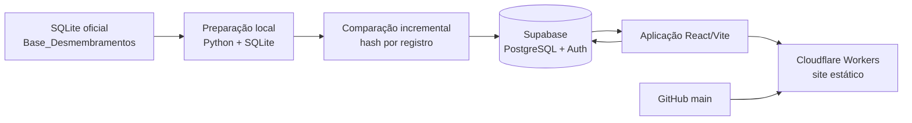

# Histórico — Documentação do projeto de 15/09/2026

Não é o manual atual. Contém regras, tempos de reserva e procedimentos anteriores à migração Azure. Consulte `../DOCUMENTACAO_PROJETO.md`; não execute SQL ou restauração com base neste histórico.

Atualizado em 15/09/2026.

## 1. Objetivo

O projeto transforma os indícios de duplicidade e desmembramento existentes na
base oficial do Censo Rural em uma fila web de revisão humana. A aplicação permite:

- comparar duas matrículas e suas evidências visuais;
- impedir que duas pessoas revisem o mesmo caso simultaneamente;
- permitir que os conferentes escolham livremente seus recortes de trabalho;
- registrar decisões e dados complementares de desmembramentos;
- acompanhar a produtividade da equipe por período;
- atualizar a base de referência sem apagar o histórico das revisões.

## 2. Visão geral da arquitetura



Responsabilidade de cada componente:

- **SQLite oficial:** fonte dos dados do Censo Rural.
- **Python local:** prepara, compara, protege, faz backup e sincroniza os dados.
- **Supabase:** armazena dados, autentica usuários e executa as regras de negócio.
- **React/Vite:** interface da fila, monitoramento e produtividade.
- **GitHub:** referência do código-fonte.
- **Cloudflare:** publica automaticamente o frontend a partir da branch `main`.

O arquivo SQLite não é enviado ao navegador nem ao Cloudflare. O site consulta o
Supabase utilizando a chave pública anônima e as regras protegidas do banco.

## 3. Origem oficial dos dados

A única origem válida é:

```text
DEEPESSOAS\PROJETOS - SABESP - CENSO RURAL\EXECUÇÃO\RELATORIOS\DADOS_CLIENTE\BASE_UNIFICADA_DESMEMBRAMENTOS\Banco de dados - Desmembramentos.db
```

O localizador aceita esse caminho tanto diretamente quanto dentro do OneDrive da
empresa. Uma cópia solta na Área de Trabalho é rejeitada para evitar a comparação
do Supabase com versões diferentes da base.

A tabela lida na origem é `Base_Desmembramentos`. Os principais campos são:

| Campo de origem | Uso no sistema |
|---|---|
| `ID_Completo` | Código da matrícula atual |
| `Codigo_Suspeito` | Código da matrícula relacionada |
| `Status_Validacao` | Classificação que origina o tipo da ocorrência |
| `Percentual_Similaridade` | Similaridade do par |
| `Detalhe_Inconsistencia` | Motivo técnico da ocorrência |
| `1.4 Município_field` | Município oficial já tratado |
| `1.6 Logradouro_field` | Endereço da matrícula |
| `Nome do Agente` | Agente responsável pela visita |
| `Data do registro` | Data da evidência |
| campos de fotografia | Imagem utilizada na comparação |
| campos de Backoffice | Link e situação da visita no Backoffice |

O município não é inferido nem corrigido por aproximação. O sistema copia o valor
já tratado de `1.4 Município_field`.

### Regra de escopo por similaridade

Casos classificados como `Possível imóvel duplicado` ou `Revisão visual
recomendada` entram na fila e nos totais operacionais somente quando
`Percentual_Similaridade` é maior ou igual a 80%. Casos desses dois tipos abaixo
de 80%, ou sem percentual, permanecem no Supabase como casos inativos: não
aparecem como pendência, não impedem a conclusão do município e podem ser
reativados por uma mudança futura da regra. Os demais tipos de ocorrência não
usam esse corte e revisões já existentes nunca são apagadas.

## 4. Como os registros são formados

### 4.1 Matrículas

A tabela `matriculas` contém uma linha por código de imóvel. Ela guarda os dados
próprios de cada matrícula:

- código;
- foto e origem da foto;
- foto adicional da estrutura, quando disponível;
- link do Backoffice;
- agente;
- data do registro;
- endereço;
- complemento do endereço;
- município;
- situação da visita no Backoffice;
- hash do conteúdo.

Uma matrícula pode participar de vários casos, mas seus dados são armazenados uma
única vez. Isso evita repetir fotos, endereço e município em todos os pares.

### 4.2 Casos

A tabela `casos` representa a relação entre duas matrículas que precisa ser
analisada. Ela contém:

- `caso_id`;
- `code_a` e `code_b`;
- tipo da ocorrência;
- status e detalhe da origem;
- similaridade;
- `municipio_a` e `municipio_b` para acelerar a fila;
- versão e hash da carga;
- indicador `ativo`.

Os códigos do par são ordenados antes da criação do identificador. O `caso_id` é
derivado de `SHA-256(code_a|code_b)`, portanto o par A–B e o par B–A representam o
mesmo caso.

`municipio_a` e `municipio_b` não são municípios diferentes inventados pelo app.
São cópias dos municípios das duas matrículas relacionadas. Durante a preparação,
esses campos são novamente alinhados com a tabela `matriculas`.

### 4.3 Revisões e reavaliações

A tabela `revisoes` guarda o resultado humano vigente, uma linha por caso. Atualmente as
decisões apresentadas no aplicativo são:

- Duplicidade;
- Desmembramento;
- Falso positivo;
- Inconclusivo;
- Já realizado anteriormente.

Quando a decisão exige, também são armazenados o lado A/B e, no desmembramento,
o novo código DEEP. A revisão registra usuário, nome, data e versão da base.

Ao usar `Rever`, um gatilho copia o resultado anterior para
`revisoes_historico` antes da atualização. Assim, a fila apresenta somente a
decisão vigente, enquanto a produtividade preserva cada trabalho com seu autor e
data originais.

Embora o nome histórico `revisoes` possa sugerir uma lista de eventos, sua função
é armazenar o **resultado vigente** de cada caso. `revisoes_historico` armazena
somente os resultados que foram substituídos. As tabelas físicas não foram
renomeadas porque várias RPCs, gatilhos, índices e rotinas operacionais dependem
desses nomes; a distinção conceitual deve ser mantida nesta documentação:

| Estrutura | Significado |
|---|---|
| `revisoes` | Uma decisão vigente por `caso_id` |
| `revisoes_historico` | Versões anteriores preservadas antes de uma reavaliação |
| produtividade | União do resultado vigente com as versões anteriores |

### 4.4 Classificação das tabelas atuais

| Tabela | Classe | Uso atual |
|---|---|---|
| `casos` | Essencial | Pares que compõem a fila |
| `matriculas` | Essencial | Dados, fotos e links de cada imóvel |
| `revisoes` | Essencial | Resultado vigente de cada caso |
| `revisoes_historico` | Essencial | Resultados substituídos por reavaliações |
| `reservas` | Essencial e temporária | Exclusividade enquanto um caso está aberto |
| `perfis` | Essencial | Nome, cargo e ativação dos usuários |
| `atividade_conferentes` | Operacional e temporária | Monitoramento da atividade recente |
| `opcoes_municipios_fila` | Cache | Carregamento rápido dos municípios |
| `opcoes_tipos_fila` | Cache | Carregamento rápido dos tipos |
| `distribuicoes` | Legada | Vazia; mantida temporariamente para reversibilidade |

### 4.5 Reservas

A tabela `reservas` controla o uso simultâneo. Quando alguém abre um caso:

1. o Supabase verifica se o usuário pode acessar aquele recorte;
2. cria uma reserva exclusiva para o caso;
3. outras pessoas visualizam o caso como `Em uso`;
4. a reserva dura 10 minutos e é renovada a cada 2 minutos enquanto a análise
   permanece aberta;
5. ao salvar ou fechar corretamente, a reserva é liberada;
6. se o navegador for abandonado, ela expira em até 10 minutos.

As validações também existem no banco. Portanto, alterar apenas a interface não
permite acessar ou revisar um caso fora do escopo autorizado.

### 4.6 Perfis e autenticação

O login é realizado pelo Supabase Auth. A tabela `perfis` complementa o usuário
autenticado com nome, função e situação ativa.

| Perfil | Acesso |
|---|---|
| `conferente` | Fila livre, filtros e produtividade pessoal |
| `gestor` | Fila livre, monitoramento e produtividade da equipe |
| `admin` | Mesmo acesso operacional do gestor e administração técnica geral |

Para promover uma pessoa a supervisora, altere somente `perfis.perfil` para
`gestor`. Não é necessário alterar `auth.users`, matrículas ou casos.

## 5. Organização do trabalho

A fila é livre. Cada conferente escolhe etapa, município, tipo e similaridade sem
receber uma distribuição prévia. Mais de uma pessoa pode trabalhar no mesmo
município; a reserva exclusiva garante que não abram o mesmo caso ao mesmo tempo.

O painel de monitoramento mostra o filtro e o caso aberto de cada pessoa, sem
limitar seu acesso. A tabela e as RPCs antigas de `distribuicoes` permanecem
temporariamente apenas para reversibilidade e serão arquivadas depois de um
período estável em produção.

A proposta anterior de lotes físicos foi encerrada. Toda a implementação foi
reunida em `historico/lotes/`, fora de `src/`, `tests/` e `sql/` ativos. Esses
arquivos servem apenas para rastreabilidade e não devem ser executados em produção.

## 6. Fluxo de uso da aplicação

### Conferente

1. Entra com e-mail e senha.
2. Escolhe entre `Disponíveis`, `Em análise` e `Concluídos`.
3. Abre um caso disponível.
4. Compara imagens, dados e Backoffice das matrículas A e B.
5. Seleciona a decisão e preenche os campos obrigatórios.
6. Salva a revisão.
7. O caso deixa a lista de pendentes; se a preferência estiver ligada, o próximo
   caso é aberto automaticamente.

Cada usuário pode ligar ou desligar `Próximo automático`. A preferência fica no
navegador. Reavaliações são sempre pontuais e nunca abrem outro caso em seguida.

Na comparação, cada matrícula pode apresentar a foto principal e a foto da
estrutura em um carrossel. Setas e indicadores aparecem somente quando existe
mais de uma URL diferente. O complemento é exibido separadamente do logradouro.

Cada pessoa também possui “Minha produtividade”, com total do período e produção
por dia e por tipo de decisão. A consulta usa o usuário autenticado, portanto não
depende do município ou do recorte que estiver sendo trabalhado.

### Gestor ou administrador

- visualiza toda a fila e aplica filtros por etapa, município, tipo e similaridade;
- acompanha em tempo quase real o recorte e o caso aberto por cada pessoa;
- consulta produtividade por intervalo de datas;
- acompanha totais por tipo de decisão;
- consulta os desmembramentos registrados no período.

## 7. Atualização diária da base

Na rotina normal, execute somente:

```text
ATUALIZAR_BASE_DIARIA.bat
```

O fluxo possui cinco etapas:

1. **Preparar base local:** lê o SQLite oficial e gera uma base web compacta.
2. **Simular alterações:** compara hashes e estados com o Supabase sem escrever.
3. **Criar e validar backup:** executada somente após digitar `ATUALIZAR`.
4. **Sincronizar Supabase:** envia matrículas e casos novos ou alterados em lotes.
5. **Verificar resultado:** repete a simulação; os totais devem ficar próximos de zero.

Cada execução gera relatório em `logs/atualizacoes/`. Uma trava local impede duas
atualizações simultâneas.

### Sincronização incremental

O sincronizador calcula um hash do conteúdo de cada matrícula e caso. Ele envia
somente registros:

- inexistentes no Supabase;
- cujo conteúdo mudou;
- que precisam ser reativados.

Na rotina diária, casos que estavam ativos no Supabase e desapareceram da origem
permanecem ativos. A fotografia diária é tratada como fonte de inserções e
atualizações, pois a ausência não comprova uma exclusão. Revisões, históricos,
perfis e a estrutura legada de distribuições são preservados.

Somente a reconciliação excepcional pode desativar ausentes. Se mais de 20% dos
casos ativos seriam desativados, ela exige a autorização massiva explícita.

### Reconciliação excepcional

Uma substituição massiva intencional deve usar somente:

```text
manutencao\RECONCILIAR_BASE_OFICIAL.bat
```

Essa rotina exige a frase `RECONCILIAR BASE OFICIAL`, aceita exclusivamente o
caminho oficial e deve ser usada apenas depois de confirmar backup e capacidade
do Supabase. Não utilize a opção de desativação massiva diretamente no BAT diário.

## 8. Backup e restauração

Para um backup avulso, execute:

```text
manutencao/FAZER_BACKUP_SUPABASE.bat
```

O backup atual inclui:

- `revisoes`;
- `revisoes_historico`;
- `perfis`;
- `distribuicoes`;
- `sincronizacoes`, quando essa tabela existir no projeto;
- usuários do Supabase Auth.

O resultado é compactado em `backups/`, recebe checksum SHA-256 e é validado após
a criação. Antes de restaurar, consulte `manutencao/RESTAURAR_BACKUP.md`.

O backup operacional não é uma cópia física completa do PostgreSQL. Para mudanças
estruturais ou exclusões importantes, complemente-o com os recursos de backup do
plano contratado no Supabase.

## 9. Segurança

- O frontend utiliza apenas `VITE_SUPABASE_URL` e `VITE_SUPABASE_ANON_KEY`.
- A chave `service_role`/secret permanece somente nos scripts locais.
- `.env.local`, secrets, bancos e backups não devem entrar no Git.
- As tabelas operacionais usam RLS e funções `security definer` com validação de perfil.
- As funções de reserva e revisão validam novamente o escopo no banco.
- Usuário inativo não entra no aplicativo.
- O perfil `gestor` recebe somente capacidades operacionais de supervisão.

Nunca coloque uma chave privada em `src/`, no GitHub ou nas variáveis públicas do
Cloudflare.

## 10. Publicação do site

O fluxo de publicação é:

1. alterar o código;
2. executar `npm run build`;
3. revisar e criar o commit;
4. enviar a branch `main` ao GitHub;
5. aguardar o deploy automático do Cloudflare;
6. validar o endereço publicado.

Uma falha `503 Service Unavailable` do Wrangler/Cloudflare após o upload costuma
ser temporária. Se a compilação passou, repita o deploy ou aguarde o próximo deploy
do GitHub; não altere o código apenas por causa desse erro de infraestrutura.

Atualizar dados no Supabase não exige novo deploy do frontend. Alterações de SQL
que modificam funções chamadas pela tela devem ser executadas antes de publicar o
frontend correspondente.

## 11. Desenvolvimento local

Pré-requisitos:

- Node.js e npm;
- Python;
- dependências de `requirements-local.txt`;
- `.env.local` com as variáveis públicas;
- `.streamlit/secrets.toml` com as credenciais privadas dos scripts locais.

Instalação:

```powershell
python -m pip install -r requirements-local.txt
npm ci
```

Execução local:

```text
manutencao\INICIAR_WEB.bat
```

Validação do frontend:

```powershell
npm run build
```

## 12. Organização dos arquivos

| Caminho | Finalidade |
|---|---|
| `src/main.jsx` | Interface e fluxo principal da aplicação |
| `src/styles.css` | Aparência e responsividade |
| `src/supabase.js` | Cliente público do Supabase |
| `scripts/sincronizar_base.py` | Leitura da origem e formação dos pares |
| `scripts/preparar_base_web.py` | Criação do SQLite intermediário compacto |
| `scripts/sincronizar_supabase_web.py` | Comparação e envio incremental |
| `scripts/atualizar_base_diaria.py` | Orquestração segura das cinco etapas |
| `scripts/backup_supabase.py` | Backup operacional e verificação de integridade |
| `ATUALIZAR_BASE_DIARIA.bat` | Entrada da rotina diária |
| `manutencao/FAZER_BACKUP_SUPABASE.bat` | Entrada do backup avulso |
| `docs/` | Documentação técnica e operacional vigente |
| `scripts/` | Módulos Python ativos |
| `sql/migracoes_aplicadas/` | Histórico de migrações já executadas |
| `sql/` | Somente auditorias e exportações ainda utilizáveis |
| `ferramentas/` | Diagnósticos somente quando necessários |
| `manutencao/` | Instalação, desenvolvimento e rotinas excepcionais válidas |
| `historico/` | Protótipos, correções e documentos encerrados; não executar |

Arquivos SQL antigos são histórico, não uma sequência para executar novamente.
Antes de aplicar qualquer SQL, confira o commit, a finalidade e se ele já foi usado.
A validação automatizada permanente do frontend é `npm run build`. Testes pontuais
das migrações já aplicadas estão preservados em `historico/`.

## 13. Operação recomendada

### Todos os dias de atualização

1. Confirmar que o SQLite oficial terminou de ser gerado e sincronizado.
2. Fechar outras rotinas de atualização.
3. Executar `ATUALIZAR_BASE_DIARIA.bat`.
4. Conferir os totais da simulação.
5. Digitar `ATUALIZAR` somente se os números forem coerentes.
6. Guardar o relatório final.
7. Verificar se a segunda simulação ficou próxima de zero.

### Periodicamente

- acompanhar o uso de armazenamento do Supabase;
- executar `sql/AUDITAR_LIMPEZA_BASE.sql` em modo somente leitura;
- verificar reservas expiradas e casos inativos sem apagar histórico;
- testar login de conferente e gestor;
- validar se o deploy do Cloudflare corresponde ao último commit da `main`;
- confirmar que backups recentes podem ser lidos e validados.

## 14. Solução de problemas

### Muitos casos seriam desativados

Não force a atualização diária. Confirme o caminho da origem, a quantidade de
registros e se o arquivo oficial realmente mudou. Use a reconciliação excepcional
somente se a redução for intencional.

### Município aparece incorreto

Confirme primeiro `1.4 Município_field` na matrícula correspondente da origem. Em
seguida verifique `matriculas.municipio` e os campos duplicados em `casos`. Não crie
nova normalização aproximada se a origem já estiver tratada.

### Caso está “Em uso”

Outra sessão possui uma reserva válida. Aguarde a conclusão, o fechamento ou a
expiração de até 10 minutos. Não apague reservas ativas manualmente.

### Usuário fica em “Carregando perfil”

Verifique se há uma linha em `perfis` com o mesmo UUID de `auth.users`, se ela está
ativa e se o perfil é `conferente`, `gestor` ou `admin`.

Se um convite falhar com a constraint `perfis_perfil_check`, execute
`sql/CORRIGIR_CONVITE_NOVO_CONFERENTE.sql`. A correção alinha o valor padrão de
`perfis.perfil` e a função de criação ligada a `auth.users` com o cargo
`conferente`; depois, repita o convite.

### Gestor não vê as telas administrativas

Confirme `perfis.perfil = 'gestor'`, atualize a sessão e verifique se a migração
`sql/migracoes_aplicadas/HABILITAR_PERFIL_GESTOR.sql` e o frontend correspondente
já estão publicados.

### Deploy Cloudflare falha com 503

Trata-se normalmente de indisponibilidade temporária da API. Confirme se o commit
está no GitHub e tente novamente. Um upload bem-sucedido seguido de erro 503 não
indica necessariamente falha no código.

### Supabase se aproxima do limite

Evite exclusões improvisadas. Meça tabelas e índices com as auditorias existentes,
preserve revisões e reservas vinculadas e planeje upgrade antes de uma reconciliação
massiva. Casos inativos podem fazer parte da rastreabilidade.

## 15. Regras que não devem ser quebradas

1. Usar somente a base oficial como origem.
2. Nunca executar duas sincronizações ao mesmo tempo.
3. Sempre simular e fazer backup antes do envio real.
4. Não ignorar o bloqueio de desativação massiva sem causa confirmada.
5. Não apagar matrículas, casos, revisões ou reservas manualmente por tentativa.
6. Não executar a ativação do protótipo de lotes.
7. Não publicar secrets ou chaves privadas.
8. Executar SQL dependente antes do frontend que o utiliza.
9. Tratar o GitHub `main` como referência do código, preservando dados e secrets locais.

## 16. Estado funcional em 15/09/2026

- frontend React/Vite em produção pelo Cloudflare;
- autenticação pelo Supabase;
- perfis `conferente`, `gestor` e `admin`;
- fila livre com filtros por etapa, município, tipo e similaridade;
- monitoramento do recorte e da atividade da equipe;
- reserva exclusiva com renovação automática;
- decisões incluindo falso positivo, inconclusivo e indicação A/B;
- histórico seguro de reavaliações;
- produtividade pessoal e da equipe por intervalo de datas;
- sincronização incremental com proteção de 20%;
- backup automático antes da atualização;
- municípios provenientes diretamente de `1.4 Município_field`;
- protótipo de lotes desativado e isolado em `historico/lotes/`.
